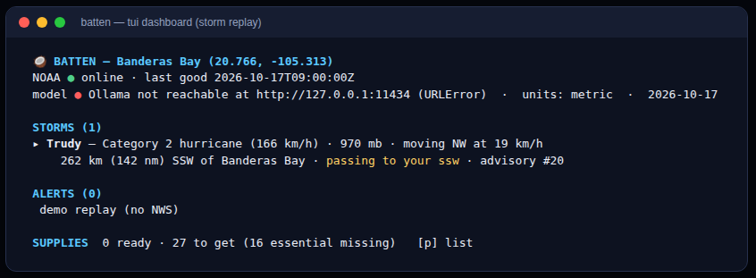
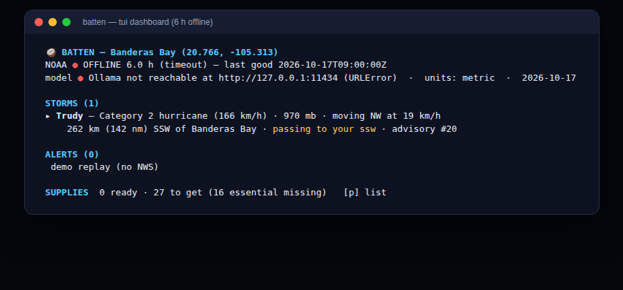
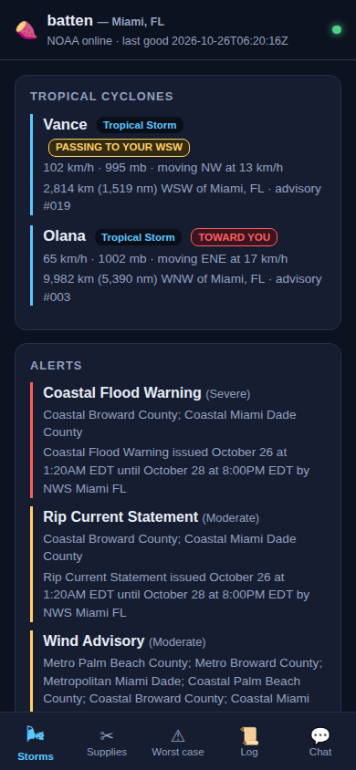
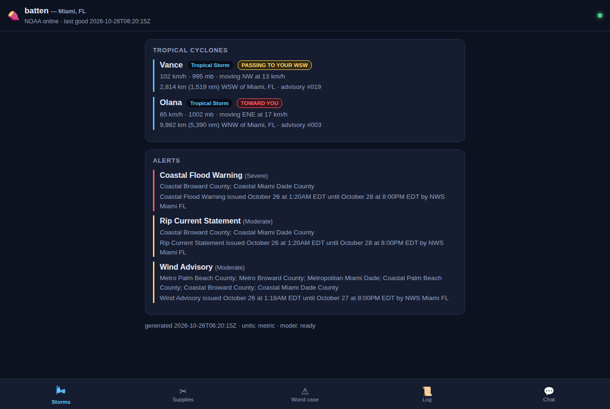
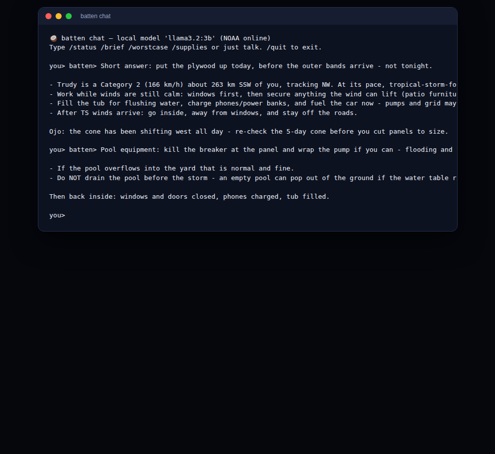
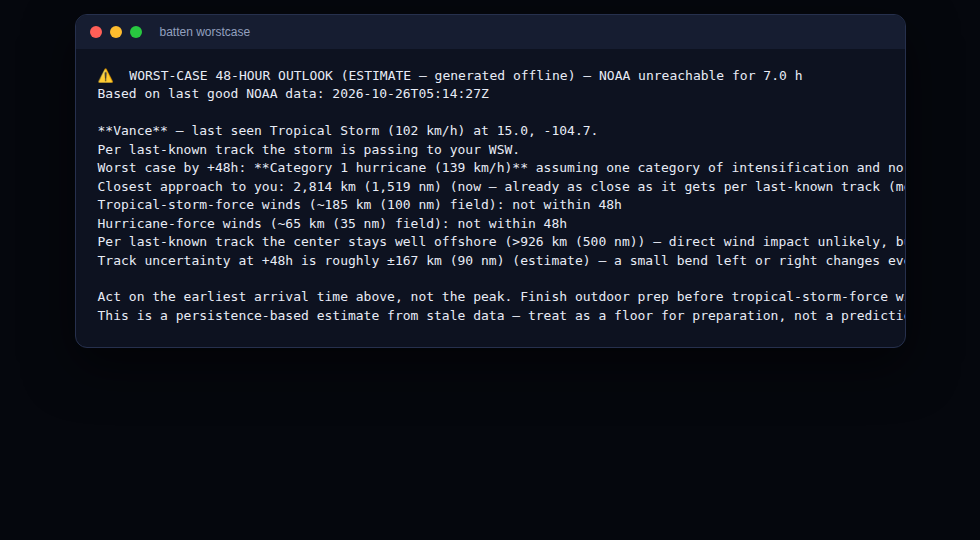
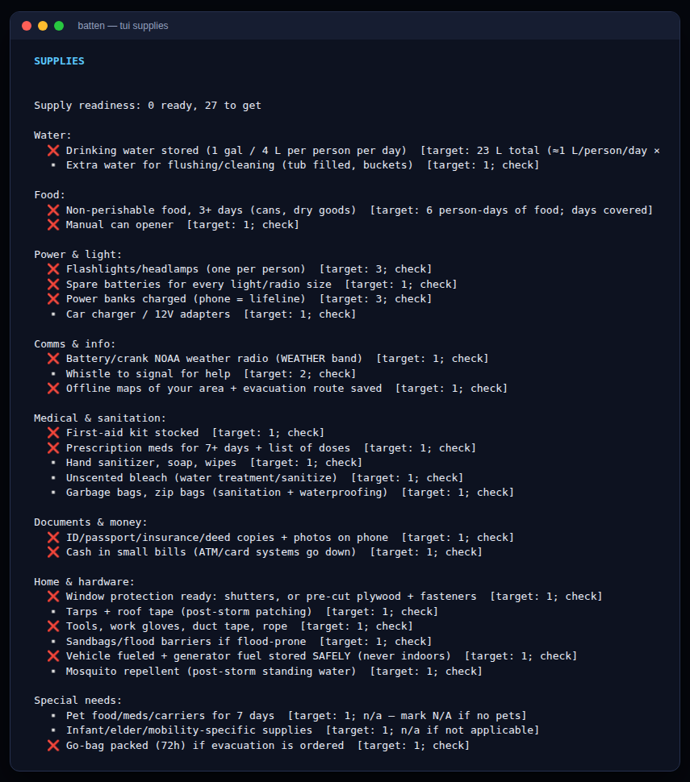
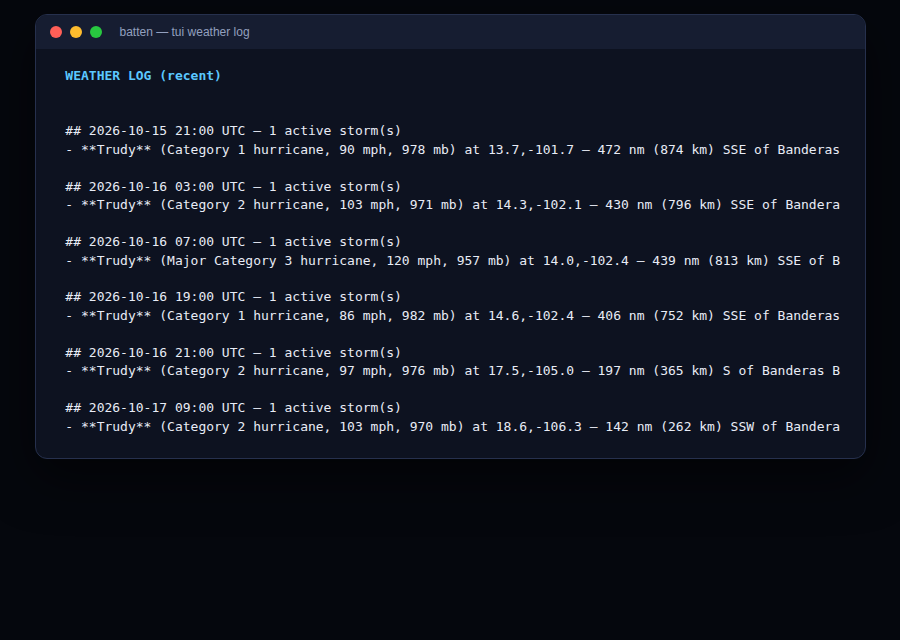

# 🥥 Batten

**An offline-first severe weather copilot.** Batten watches NOAA's trackers for
your location, keeps a running storm log, tracks your household's supply
readiness, and chats with you about all of it through a local open-weight
model. When the internet dies mid-storm, it keeps working: it warns you that
NOAA is unreachable, tells you _why_, and after a few hours offline it builds
a worst-case 48-hour outlook from the last good data so you can plan while
you're in the dark.

Use it three ways: a plain **CLI**, a full-screen **terminal dashboard**
(PC/Mac/Linux), or a **local web dashboard** served on your LAN — open it on
your phone while you're boarding up the windows. No cloud, no accounts, no
subscription.

> Batten: _(verb)_ — to batten down the hatches; to secure everything before a storm.

Inspired by a real storm-season Discord bot that spent five days watching a
hurricane for a first-time homeowner — every two hours, day and night.

---

## Screenshots

|                                                 |                                                     |
| ----------------------------------------------- | --------------------------------------------------- |
|  |  |
| _TUI dashboard, storm replay, metric units_     | _Same dashboard, 6 h into an outage_                |
|          |          |
| _LAN dashboard on a phone (live NOAA data)_     | _The same server from a laptop_                     |
|                    |             |
| _Chat on a local model_                         | _Worst-case 48-h outlook from stale data_           |
|        |                      |
| _Supply readiness checklist_                    | _Every poll persisted to the weather log_           |

More in `screenshots/`: the CLI (`status.png`, `demo.png`,
`web-phone-supplies.png`, `web-phone-worstcase.png`).

## Why the open core matters

Everything that makes Batten _Batten_ runs on your machine, with open pieces:

- **The brain is an open-weight model running locally** (via
  [Ollama](https://ollama.com) — Llama, Qwen, Gemma, Mistral, anything you've
  pulled). Chat, briefings, and the worst-case action plan are generated on
  your laptop. **When a storm takes your internet down — the exact moment you
  want a weather assistant — the AI keeps working.** A cloud-model assistant
  goes dark precisely when you need it most. That's not a hypothetical; it's
  the failure mode this tool is built around.
- **Your data stays yours.** Coordinates, household size, supply list, and
  every "are we going to be okay?" live in `~/.batten/` and never leave your
  machine (except to your own devices on your own LAN). No account, no
  telemetry, no prompt logs on someone else's server.
- **Zero cost, zero dependencies.** The whole thing is Python stdlib — no pip
  installs at all. Set it up once, run it forever, pay nothing per query. A
  3B model runs fine on a laptop.
- **Swappable and inspectable.** Don't like the model? `batten init --model
qwen2.5:7b`. Don't like how the watcher phrases things? It's ~60 lines of
  prompt. Want a different worst-case doctrine? The engine is a documented,
  pure-Python module you can read and change. Try that with a subscription
  API.

The deterministic safety loop is deliberately _not_ LLM-dependent: trigger
detection, connectivity monitoring, and the worst-case math are plain code so
they work under load, on battery, with the model cold. The open model sits on
top and turns numbers into judgment.

## What it does

| When online                                                                                                                                | When offline                                                                                        |
| ------------------------------------------------------------------------------------------------------------------------------------------ | --------------------------------------------------------------------------------------------------- |
| Polls NHC every 2h (30 min when alerts are active or a storm is near)                                                                      | Keeps retrying every 10 min                                                                         |
| Watches alerts from any configured provider: NWS (US), CAP 1.2 feeds (worldwide), or any JSON endpoint                                     | Marks the gap, keeps NHC history                                                                    |
| Alerts on: new storms, category changes, rapid intensification, landfall statements, watch/warning changes, 300/150 nm proximity crossings | **Warns you immediately** that NOAA is unreachable, with the cause (DNS vs timeout vs server error) |
| Frames every storm relative to you: distance, bearing, and whether it's **headed toward you**, moving away, or passing                     | After **6 h** offline, fires a **worst-case 48-hour outlook** built from last-good data             |
| Logs every poll to a human-readable `weather-log.md`                                                                                       | Chat still works — the model is local; it answers from the log                                      |
| Console + TUI + LAN web dashboard + optional Discord webhook                                                                               | Console and TUI always work                                                                         |

## Quick start

```bash
# 1. Get the repo — no dependencies to install
git clone https://github.com/JamesDBartlett3/Batten.git && cd Batten
python3 -m batten --help          # runs from the checkout

# 2. Install Ollama (https://ollama.com) and pull an open-weight model
ollama pull llama3.2:3b           # any model works; 3B is laptop-friendly

# 3. Configure your location (GPS coordinates or US ZIP)
python3 -m batten init --lat 29.76 --lon -95.37 --place "Houston, TX" \
    --tz America/Chicago --household 4 --units metric
python3 -m batten init --zip 77002            # ZIP geocoding, when online

# 4. Check the whole stack
python3 -m batten doctor

# 5. Fill in your supply list (scales with household size)
python3 -m batten supplies
python3 -m batten supplies have water "12 gallons in the pantry"

# 6. Pick your interface
python3 -m batten watch     # background watcher: polls, logs, alerts
python3 -m batten tui       # full-screen terminal dashboard
python3 -m batten serve     # web dashboard for every device on your LAN
python3 -m batten chat      # talk to the local model about your situation
```

Or install it: `pip install .` gives you a `batten` command.

### See it work without a storm

Batten ships with a replay of a **real hurricane lifecycle** (East Pacific,
October 2026 — advisories transcribed from an actual watcher's log), including
a simulated internet outage:

```bash
python3 -m batten demo              # CLI replay, triggers + outage + worst-case
python3 -m batten tui --headless frames --source demo   # TUI frames, no network
```

You'll see it detect the storm, fire the category-change and rapid-
intensification triggers, warn "cannot reach NOAA" when the simulated outage
hits, and at the six-hour mark produce the worst-case 48-hour outlook from the
last good advisory. Fully offline, about fifteen seconds.

## Alert providers (pluggable)

Out of the box Batten uses the US National Weather Service for point alerts
(`api.weather.gov`, US + territories). Any other alert service can be plugged
in via `alert_providers` in `~/.batten/config.json` — built-ins:

```json
"alert_providers": [
  {"type": "nws"},
  {"type": "cap",
   "url": "https://met-service.example/alerts.atom",
   "area_filter": "Oaxaca"},
  {"type": "generic",
   "url": "https://city.example/api/alerts.json",
   "headers": {"Authorization": "Bearer ..."},
   "list_path": "alerts",
   "fields": {"event": "alertType.name", "area": "region.description"}}
]
```

- **`nws`** — NWS active alerts for your coordinates (built-in default).
- **`cap`** — OASIS [Common Alerting Protocol](https://oasis-open.github.io/cap-resources/)
  1.2 feeds in Atom/RSS form: the standard format most national weather
  services publish. Namespace-tolerant parsing; optional `area_filter`.
- **`generic`** — any JSON endpoint: `list_path` locates the array, `fields`
  maps dotted paths (with `a|b|c` fallbacks and sane defaults) onto Batten's
  alert shape.

Multiple providers merge and are deduplicated; a failing provider becomes a
note and never takes the others down. Check them with `batten doctor`.

## Units and location

- `batten init --units metric` (or `imperial`) — every render path honors it:
  wind speeds, distances, rainfall, temperature, supply volumes. Internals
  stay in NHC-native units; conversion happens only at render time.
- Location is GPS coordinates (`--lat/--lon`) or a US ZIP (`--zip`, geocoded
  when online). Everything is framed relative to that point: each storm gets a
  distance, a bearing, and a heading relation — **toward you** (red), **away
  from you** (green), or **passing to your W/SW** (yellow) — computed from the
  angle between the storm's track and its bearing to you.

## The outage playbook (the point of the whole thing)

1. **Detection.** Every poll classifies failure: `dns` (internet down /
   captive portal), `timeout` (weak signal, congestion, ISP outage), `http`,
   or `parse`. NWS not covering your country is _not_ an outage — it's
   reported as a coverage note.
2. **Immediate warning.** The first failed poll after a good one emits:
   _"⚠️ Cannot reach NOAA — operating on last known data. Cause: connections
   timing out… I'll keep retrying every 10 min and build a worst-case outlook
   if this lasts 6 h."_
3. **Persistence.** Every poll — good or bad — is written to
   `~/.batten/weather-log.md` with source timestamps. That log is the model's
   memory while offline.
4. **The 6-hour mark.** Still offline after `outage_worstcase_hours` (default
   6), Batten fires the **worst-case 48-hour outlook**: persistence
   extrapolation of the storm's last known track and intensity, deliberately
   pessimistic (+20 kt ≈ one Saffir-Simpson category, no weakening assumed),
   wind-field radii, track-uncertainty growth, rainfall bands by storm speed —
   every line labeled `ESTIMATE` with the timestamp of the last good data. The
   local model then turns it into a short, calm action plan. If the model is
   down too, the numbers go out as-is.
5. **Recovery.** When NOAA answers again you get _"✅ NOAA is back after X h
   offline"_, and the state machine resets.

Run the engine any time: `batten worstcase --outage-hours 7 --narrate`.

## Commands

```
batten init        configure location (lat/lon or US ZIP), units, household, model, webhook
batten status      current picture: storms, alerts, connectivity, supplies, model
batten brief       one-shot briefing narrated by the local model
batten chat        chat with the local model (works fully offline; /status /worstcase /supplies)
batten watch       the watcher loop (also: --once for cron)
batten tui         full-screen terminal dashboard (--headless DIR renders frames to files)
batten serve       web dashboard on your LAN (phones included); data API at /api/*
batten worstcase   worst-case 48h outlook on demand (--outage-hours N --narrate)
batten cone        download the active storm's full-resolution NHC forecast cone
batten supplies    household supply checklist (have/need/na/note <item>)
batten doctor      check config, NOAA, alert providers, Ollama, webhook
batten selftest    full offline test suite (155 tests)
batten demo        replay a real storm lifecycle offline, outage included
```

Notifications go to the console always, and to a Discord webhook if you set
one (`batten init --webhook …`) — with retries, rate-limit handling, and a
console fallback, because a silently-dropped storm alert is worse than no
alert. Quiet hours (23:00–07:00 local) suppress routine updates; real triggers
break through.

### The web dashboard

`batten serve` binds `0.0.0.0:8787` (configurable) and prints the URLs any
phone/laptop on the same network can open. It's a single self-contained page —
no external assets, works offline once loaded — over a stdlib HTTP server with
a JSON API (`/api/status`, `/api/worstcase`, `/api/supplies`, `/api/log`,
`/api/chat`). Supplies are tappable; views are deep-linkable (`?view=supplies`).
There is no authentication: it serves read-mostly weather data to your LAN.
Set `web_host` to `127.0.0.1` in config.json to keep it on one machine.

## Data sources and honest limits

- **[NHC CurrentStorms.json](https://www.nhc.noaa.gov/cyclones/#current-activity)**
  — active tropical cyclones, Atlantic + Eastern/Central Pacific (this covers
  the Caribbean, Gulf, and Mexico coasts). Public advisory text is fetched and
  grepped for landfall statements. The full-res forecast cone is downloaded
  directly (NHC blocks bot user-agents on link previews, so Batten fetches the
  image itself).
- **[api.weather.gov](https://www.weather.gov/documentation/services-web-api)** —
  active alerts and point forecasts for **US states and territories only**.
  Outside that coverage Batten says so explicitly, leans on NHC products, and
  expects you to configure a CAP or generic provider for local alerts.
- **The worst-case engine is a planning aid, not a forecast.** It assumes the
  storm keeps its last heading and speed and gets one category stronger — a
  deliberately pessimistic persistence model with inflated error bars. It is
  wrong in the direction of caution. **Always obey official orders from your
  civil-protection/emergency-management authority; Batten never decides
  whether you evacuate.**

## How it's built

```
batten/
├── geo.py         great-circle math, Saffir-Simpson mapping, heading relations
├── units.py       render-time imperial/metric formatting
├── errors.py      FetchError with machine-readable failure kinds
├── noaa.py        NHC client, cone fetch, geocoding, transport (fakeable)
├── providers/     pluggable alerts: nws / cap / generic_json + registry
├── state.py       connectivity state machine, storm snapshots, weather log
├── worstcase.py   the 48h offline extrapolation engine (documented assumptions)
├── supplies.py    ready.gov-derived checklist, household scaling
├── brain.py       Ollama client (streaming), prompts, status snapshots
├── watcher.py     poll loop: triggers, adaptive cadence, quiet hours, outage fires
├── tui.py         ANSI terminal dashboard (+ headless frame renderer)
├── web.py         LAN web server + embedded single-page UI
├── replay.py      offline storm-lifecycle replay (demo + tests)
├── tests/         155 offline tests — nothing in CI touches the network
└── cli.py         the batten command
```

- **Zero runtime dependencies** — Python ≥ 3.10 stdlib only. The Ollama
  client is ~40 lines of `urllib`; the web server is `http.server`.
- Clocks, fetchers, and HTTP transports are injectable everywhere — that's how
  `demo`, `selftest`, and `tui --headless` exercise outages, trigger storms,
  and render frames without touching the network or your real `~/.batten`.

Run tests two ways:

```bash
python3 -m batten selftest
python3 -m unittest discover -t . -s batten/tests -v
```

Suggested systemd unit (runs as your user, survives logins):

```ini
# ~/.config/systemd/user/batten.service
[Unit]
Description=Batten severe weather watcher

[Service]
ExecStart=%h/.local/bin/batten watch
Restart=on-failure

[Install]
WantedBy=default.target
```

`batten watch --once` is cron-safe if you prefer a timer.

## Development

```bash
python3 -m batten selftest        # 155 tests, no network required
python3 -m batten demo            # end-to-end storm replay
python3 -m batten tui --headless frames --source demo   # render TUI frames to text
BATTON_NO_MODEL=1 batten chat     # force the deterministic fallback brain
BATTON_HOME=/tmp/bt batten ...    # isolate state anywhere
```

Contributions welcome — good first issues: more alert providers (JTWC/CMC
products, national met services), surge heuristics by coast type, i18n of the
UI strings, a one-file release with PyInstaller.

## License

MIT. Data by NOAA/NWS (US public domain). Not affiliated with NOAA.

_For the two that came through while this was being written — and for whoever
reads their storm log by flashlight._
